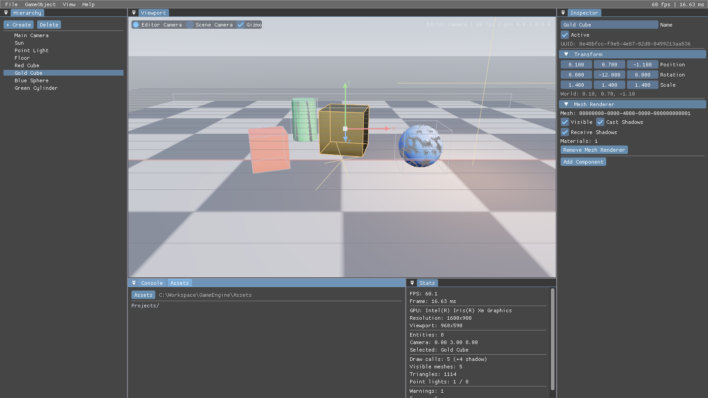

# Aegis



Aegis is a production-oriented 3D game engine for Windows, macOS and Linux (Ubuntu 24+), written in C++20 with CMake, GLFW, NVRHI on Vulkan (MoltenVK on macOS), glm, Jolt Physics, miniaudio and Lua 5.4.

## Features

- Sparse-set ECS, scene graph with UUID-based hierarchy, plain-data components
- Editor with dockable panels, hierarchy/inspector/console/assets/stats, live scene viewport,
  grid/selection overlays and a draggable translate gizmo (world axes + camera-plane handle)
- AI-controllable editor: every action is a command on a JSON API (HTTP + `AegisCli`)
- Versioned JSON scene/prefab serialisation, project manifests, export pipeline (`AegisCli export`)
- NVRHI Vulkan renderer: forward Cook-Torrance PBR, normal mapping, 2048² PCF shadow map,
  procedural sky or HDRI image-based lighting (irradiance/specular/BRDF prefiltered),
  depth-prepass SSAO, HDR → ACES tonemapping; glTF/GLB import with materials and textures
- Physics (Jolt), 3D audio (miniaudio), Lua scripting with per-entity instances and hot reload
- 175 doctest cases / 6808 assertions plus a feature project that exercises every component
- See [docs/LIMITATIONS.md](docs/LIMITATIONS.md) for the honest list of what is still missing

## Build

```powershell
./Scripts/Build.ps1 -Configuration Debug -Test
build/windows-debug/bin/AegisEditor.exe
AegisCli demo Assets/Projects/FeatureTest   # regenerate the feature project
AegisCli export Assets/Projects/FeatureTest/FeatureTest.aeproj Export/FeatureTest
```

Linux/macOS:

```bash
cmake -S . -B build/linux-debug -G Ninja -DCMAKE_BUILD_TYPE=Debug
cmake --build build/linux-debug
ctest --test-dir build/linux-debug --output-on-failure
```

## Documentation

- [AGENTS.md](AGENTS.md) — the binding development guide (style, architecture, testing)
- [docs/ARCHITECTURE.md](docs/ARCHITECTURE.md) — module map and data flow
- [docs/BUILDING.md](docs/BUILDING.md) — toolchain, presets, packaging
- [docs/AI_CONTROL.md](docs/AI_CONTROL.md) — editor command API and automation workflow
- [docs/SCRIPTING.md](docs/SCRIPTING.md), [docs/PHYSICS.md](docs/PHYSICS.md), [docs/AUDIO.md](docs/AUDIO.md)
- [docs/SERIALIZATION.md](docs/SERIALIZATION.md), [docs/RENDERING.md](docs/RENDERING.md)
- [skills/](skills) — task playbooks for AI agents

## Status

This repository is under active development; see [docs/LIMITATIONS.md](docs/LIMITATIONS.md) for the honest list of what is not implemented yet.
